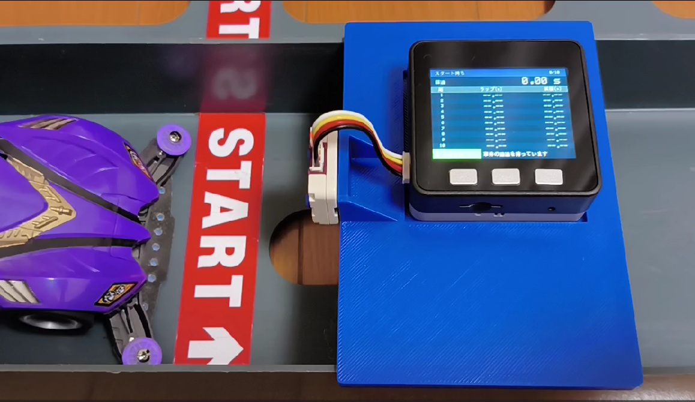
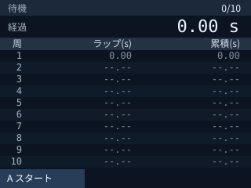
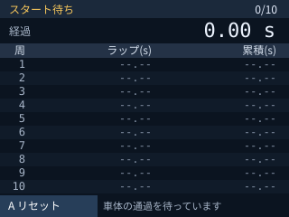
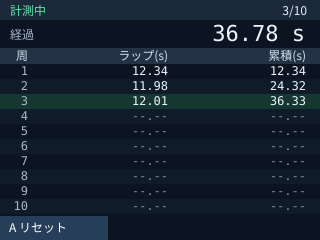
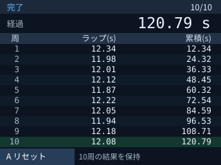

# Mini4WDLapTimer

M5StackとToF距離センサーを使った、ミニ四駆用のラップタイマーです。スタート地点で車体の通過を検出し、最大10周のラップタイムと累積時間を計測します。



## 主な機能

- 最初の車体通過を合図に計測を開始
- 10周分のラップタイムと累積時間を1画面に表示
- 計測中の経過時間をリアルタイム表示
- 時間は秒単位、小数点以下2桁で表示
- Aボタンで計測準備・リセット

## 使用デバイス

| デバイス | 用途 |
| --- | --- |
| M5Stack Core ESP32 | 計測処理、LCD表示、ボタン操作 |
| [M5Stack用ToF-90°測距センサユニット](https://www.switch-science.com/products/10486)（Unit Mini ToF-90° / U196、VL53L0X搭載） | 車体の通過検出 |
| USBケーブル | ファームウェアの書き込み |
| センサーを固定する治具 | コース上でセンサーの位置・向きを保持 |

このプロジェクトでは、側面方向に測距するToF-90°ユニットを使用しています。ユニット側面の測定面がコースを向くよう、下向きに固定してください。

付属のHY2.0-4P（Grove互換）ケーブルでM5StackのPORT.A（I²C）へ接続します。このプロジェクトではSDAにGPIO21、SCLにGPIO22を使用します。ユニットの構造・ピン配置は[M5Stack公式ドキュメント](https://docs.m5stack.com/en/unit/Unit_Mini_ToF-90)を参照してください。

## 開発環境

| 項目 | 使用環境 |
| --- | --- |
| 開発ツール | PlatformIO（VS Code拡張またはCLI） |
| ターゲット | m5stack-core-esp32 |
| フレームワーク | Arduino |
| ライブラリ | M5Unified、Pololu VL53L0X |

ライブラリは[platformio.ini](platformio.ini)の設定に従ってPlatformIOが取得します。

### ビルド・書き込み

リポジトリを取得し、PlatformIOでプロジェクトを開きます。M5StackをUSBで接続して、プロジェクトのディレクトリで次を実行してください。

```sh
git clone https://github.com/ronron-gh/Mini4WDLapTimer.git
cd Mini4WDLapTimer

# ビルド
pio run

# M5Stackへ書き込み
pio run -t upload
```

VS CodeのPlatformIOからBuild / Uploadを実行することもできます。

## 使い方

### 1. センサーを設置する

上の設置写真のように、スタート地点で車体がセンサーの下を通る位置に固定します。センサーの測定面をコースへ向け、下向きに設置してください。車体と治具が接触しない高さに調整します。

### 2. スタート待ちにする

電源を入れると待機画面が表示されます。**センサーの下に車体がいない状態で、左側のAボタンを押してください。** コースまでの距離を自動で測定し、スタート待ちになります。

<p>
  
  
</p>

画面例は機能設計書の表示イメージです。

### 3. 車体を走らせる

センサー下を最初に通過すると計測が始まります。この通過はスタートとして扱い、まだ1周目には数えません。次の通過が1周目、その後は通過するたびにラップタイムを記録します。



| 表示 | 意味 |
| --- | --- |
| 経過 | スタートから現在までの経過時間 |
| 周 | 記録した周回番号 |
| ラップ(s) | その1周にかかった時間 |
| 累積(s) | スタートから、その周の通過までの合計時間 |
| --.-- | まだ計測していない周 |

1周目のラップタイムと累積時間は同じ値になります。

### 4. 結果を確認・再計測する

10周目で計測を終了し、結果を画面に保持します。



再計測するときはセンサー下から車体を離し、Aボタンを押してください。結果をクリアし、基準距離を測り直してスタート待ちになります。計測途中でもAボタンでリセットできます。電源断や本体リセットで結果は消去されます。

### 使用上の注意

- 単一車体の計測を対象としています。
- 二重検出を防ぐため、通過検出後の1秒間は次の通過を受け付けません。
- 車体の高さ・通過速度・センサーの設置位置によって検出しやすさが変わります。設置後に通過検出を確認してください。
- 検出の距離差は暫定20mm、離脱判定は10mmです。調整する場合は[include/LapTimer.h](include/LapTimer.h)の定数を変更してください。

## 詳細資料

- [要求仕様書](docs/requirement.md)
- [FW機能設計書](docs/functional_design.md)

## ライセンス

[MIT License](LICENSE)
