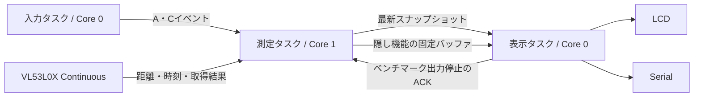
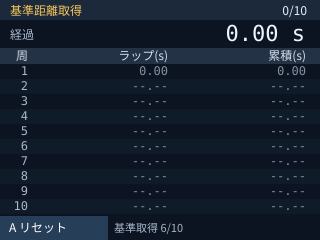
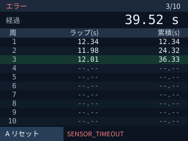
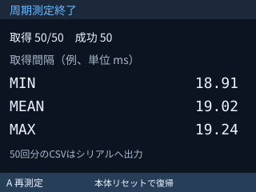

# ミニ四駆ラップタイマー 機能設計書

## 1. 位置付けと変更方針

[要求仕様書](requirement.md)を実装するための機能設計。2026-10-09作成。ここに記載する関数名、ファイル構成、タスク設定は実装予定であり、現コードにはまだ反映していない。

目的は既存の連続測定を維持しながら、10周のラップ計測、独立した表示処理、隠しベンチマークを実現すること。影響範囲は状態管理、ボタン入力、センサー取得結果の利用、LCD・シリアル出力。20msの測定時間設定、400kHzのI²C、センサーの一度だけの初期化は維持する。既存ベンチマークは機能を保持して移設する。設計書とSVGだけを追加し、実装の戻し方は作業単位のコミットを戻す方式とする。

本書で選定した更新周期・優先度などはレビュー対象。実装前にAGENTS.mdに従いステアリングファイルを作成し、レビュー完了後に着手する。

## 2. 全体構成と責務

センサーへのアクセスと計測状態の更新は測定タスクに集約する。ボタン入力は入力タスク、LCDとSerialは表示タスクが所有する。表示の遅延がラップ記録の欠落やセンサー呼び出しの待ちにならない構成とする。2コア間でもメモリコピーと通知には短い同期が伴うため、性能は実機で比較する。「影響なし」は待ち合わせを排除する設計目標であり、ゼロ遅延の保証ではない。



### タスク設定

| タスク | コア | 優先度 | 初期スタックサイズ | 起動周期・待ち |
| --- | --- | --- | --- | --- |
| measurementTask | 1 | 3 | 6144 bytes | 取得完了ごと。1サンプルごとに1tick待ってから次の取得。 |
| inputTask | 0 | 2 | 3072 bytes | 10ms周期。M5.update()とA/C判定のみ。 |
| presentationTask | 0 | 1 | 8192 bytes | 通知または50ms周期で更新。Serialは最大2Hz。 |

数値はユーザータスク間の相対優先度。ESP32版FreeRTOSのタスク生成APIに渡すスタック値はbytesとして実装する。実装時に使用SDKの定義を確認する。測定タスクの1tick待ちはアイドルタスクの実行機会を確保するためで、RTOSのtick周期と実効取得周期への影響を実機で確認する。センサーは待ち中もContinuous測定を続ける。

- センサーAPIの完了待ちは既存ライブラリのブロッキング処理を使う。正常時は約1測定分、異常時は既存の1000msタイムアウトまで入力反映が遅れる場合がある。
- 入力タスクは表示・Serialの完了を待たない。
- 表示タスクはSerial送信で待つことがあるが、測定側から呼び出さない。
- RTOSのtick数への変換は最低1tickを確保する。タスクスタックの余裕は実機のhigh-water markで確認し、使用量に余裕が残る値へ調整する。
- M5.update()は入力タスクだけ、LCD/Serialは表示タスクだけ、VL53L0X/Wireは測定タスクだけが使用する。起動時のsetup()は例外とする。

### 起動処理

1. M5.begin()、LCD向き・日本語フォント・Serial 115200bpsを設定。
2. 固定バッファ、キュー、タスク通知先を作成。
3. 既存initializeSensor()相当を一度呼び、Wireの21/22ピン、400kHz、通信20msタイムアウト、取得1000msタイムアウト、init()、20msの設定、startContinuous()を実行。
4. 成功なら待機、失敗ならエラーの初期状態を用意する。
5. 表示、入力、測定タスクを起動する。通知先がすべて有効になるまでタスク側の処理を開始させない。
6. Arduino loop()は待機のみとし、M5.update()やセンサー取得を重複実行しない。

キュー・タスク生成失敗は起動エラーとしてsetup()から最小限のLCD/Serial診断を出し、部分起動したタスクを動作開始させない。センサー起動失敗は再初期化で自動復旧させず、A操作でも起動失敗を再表示する。本体リセットが必要。

## 3. 定数とデータ

| 設定名（予定） | 値 | 用途 |
| --- | --- | --- |
| kLapCount | 10 | 記録する周回数 |
| kDetectDeltaMm | 20 | 通過検出の短縮量 |
| kReleaseDeltaMm | 10 | 離脱判定の短縮量 |
| kBaselineSamples | 10 | 基準距離の平均サンプル数 |
| kDetectionLockoutUs | 1000000 | 通過後の検出禁止時間 |
| kHiddenHoldMs | 3000 | C長押し時間 |
| kLcdPeriodMs | 50 | 最大20HzのLCD更新 |
| kSerialPeriodMs | 500 | 最大2Hzの通常Serial出力 |
| kBenchmarkSamples | 50 | 隠し機能の記録数 |

時刻・差分・ラップ時間はuint64_tのµs、距離はuint16_tのmmを使用する。時刻取得はesp_timer_get_time()。基準距離は10サンプルの合計をuint32_tで保存する。丸め誤差を避け、判定には合計値をそのまま使う。

| データ | 内容 | 所有者 |
| --- | --- | --- |
| SensorSample | API前後のµs時刻、距離、取得ステータス | 測定タスク |
| TimerContext | 状態、校正進捗、基準距離合計、検出ラッチ、最後の通過時刻、開始時刻、周数、LapRecord[10]、エラー | 測定タスク |
| LapRecord | lapUs、elapsedUs、確定済みフラグ | 測定タスク |
| DisplaySnapshot | 状態、世代番号、更新番号、開始時刻、停止時経過時間、校正進捗、10周分の記録、エラー、ベンチマーク進捗 | キューによる値コピー |
| BenchmarkResult | SensorSample[50]、取得数、設定値、エラー、出力可能フラグ | 測定後は読み取り専用 |
| InputCommand | A操作、C長押し、表示静止ACKの通知ビット | RTOSタスク通知 |

A操作で世代番号を増やす。表示側は世代変化時に旧ラップ表示をクリアする。文字列の生ポインタを共有せず、状態・エラーはenumで渡し、表示側で文言に変換する。

### 受け渡し

- 最新表示用は要素数1のFreeRTOSキュー。測定側はxQueueOverwrite()で値をコピーし、待ち時間を指定しない。表示側はローカルコピーだけを描画する。
- スナップショットは各取得後の状態変化・ラップ確定・校正進捗・異常時に送る。経過時間は開始時刻と表示側の現在時刻から計算し、毎取得で通知しなくてよい。
- スナップショットには全10周の確定記録を含めるため、途中の更新通知を上書きしても現在のラップ記録は消えない。
- A操作などはmeasurementTaskへのタスク通知ビットで渡す。表示静止ACKは別ビット。短時間の同種ボタン連打は1操作にまとめる。
- ベンチマークの50行は表示キューに流さず、測定側が固定配列に保存する。確定通知後は書き換えず、表示側が参照して出力する。

## 4. 状態とイベント

公開状態に「基準距離取得」「周期測定準備」「周期測定中」「周期測定終了」を追加する。基準距離取得はスタート待ちへ移る途中の内部状態、後3状態は隠し機能専用。

| 現状態 | イベント | 処理・次状態 |
| --- | --- | --- |
| 待機 | A | 記録クリア、基準距離取得 |
| スタート待ち・計測中・完了・エラー | A | 現計測中止、記録クリア、基準距離取得 |
| 基準距離取得 | A | 取得済みサンプルを捨て、10サンプル取得を最初から実行 |
| 基準距離取得 | 10サンプル成功 | 基準距離確定、スタート待ち |
| スタート待ち | 通過 | 開始時刻保存、計測中。ラップ数は0。 |
| 計測中 | 通過 | ラップ追加。10周目なら完了、他は計測継続。 |
| 待機 | Cを3秒長押し | 周期測定準備 |
| 周期測定準備 | 表示静止ACK | 未取得結果1回読み捨て、周期測定中 |
| 周期測定中 | 50回取得完了 | 周期測定終了、結果出力通知 |
| 通常状態 | センサー異常 | 計測終了、エラー |
| 周期測定準備・中 | 異常 | 隠し機能内で終了、エラー付き結果出力 |
| 周期測定終了 | A（結果出力完了後） | 周期測定準備へ移り、50回測定を再実行。 |
| 周期測定準備・中・結果出力中 | A | 再測定を1回予約し、現在の処理と出力の終了後に準備へ移る。連打は1回にまとめる。 |
| 隠し機能内 | C | 無視。通常機能へは本体リセットのみで復帰。 |

- 同じ取得処理の前にAとCを受け取った場合、Aを優先しCは無視する。
- 入力通知はセンサーAPIの呼び出し前と戻り直後に確認する。戻り直後にAがあれば、その取得値を旧計測の通過として記録しない。
- キャンセル要求より異常処理を優先する。新しい基準距離取得中に異常があればエラーになる。
- センサー起動成功時は通常の待機・完了・エラーでも距離取得を続ける。完了後の追加通過はラップに数えない。起動失敗でContinuous測定が開始できなかった場合は取得APIを呼ばず、50ms待ちで入力通知を確認する。
- 完了後にセンサー異常が発生した場合もエラー表示にするが、確定した10周の結果は保持する。
- エラー時の経過時間は異常検出時刻で固定し、確定済みラップを保持する。A操作で初めてクリアする。
- 長押しは一押しにつき1回通知し、離すまで再通知しない。押し始めと成立時がともに待機である場合だけ受け付ける。待機以外から押し続けても隠し機能へ入らない。

## 5. タスクから呼び出す機能

### 5.1 測定タスク

通常ループ：入力通知確認 → 必要なら状態変更 → 距離取得 → 入力通知再確認 → 取得異常判定 → 状態別処理 → 必要ならスナップショット送信 → 1tick待ち。

| 関数（予定） | 入出力・詳細 |
| --- | --- |
| initializeSensor() | 起動時のみ実行。既存の初期化・設定・startContinuous()を維持し、起動可否とエラーを返す。 |
| collectSample() | API呼び出し前後の時刻を記録し、readRangeContinuousMillimeters()の結果を取得。timeoutOccurred()、last_status、65535返値を既存順序で判定。LCD/Serialには触れない。 |
| processInputCommands() | Aなら校正開始、待機中のC成立なら隠し機能準備。状態の所有者を測定側に限定する。 |
| beginCalibration() | 世代更新、記録・通過判定初期化。未取得結果1回を読み捨ててから、後続の10回を平均対象にする。読み捨ての失敗もエラー。 |
| updateCalibration(sample) | 正常サンプルを合算。10回で平均を確定。基準取得中の通過判定はしない。 |
| updatePassDetector(sample) | 短縮量、ヒステリシス、1秒禁止時間を適用し、通過成立時のみ取得終了時刻を返す。 |
| handlePass(passUs) | スタートまたはラップ確定。開始からの累積時間と前通過からの時間をµsで保存。10件目で完了。 |
| enterError(error, timeUs) | ラップ計測を終了し、経過時間を固定。確定ラップは保持し、エラーのスナップショットを送る。 |
| publishSnapshot() | 状態全体を値コピー。キュー上書きは測定処理を表示完了まで待たせない。 |
| prepareBenchmark() | 表示静止要求を送り、ACKを待つ間も取得を継続。ACK後に未取得結果を1回読み捨てる。 |
| recordBenchmarkSample(sample) | 固定配列へ最大50件記録。異常なら残りはNOT_RUN。終了後に結果を確定して通知。 |

初期化失敗はセンサー起動不可のラッチとする。Aで校正を要求されてもinit()/startContinuous()を再実行しない。起動成功後の一時的な取得失敗は、Aによる正常な10サンプル取得で復帰可能。

#### 基準距離と通過判定

合計値をS、距離をd、サンプル数を10とする。符号付きの十分広い整数で短縮量の10倍 `delta10 = S - 10*d` を計算する。距離が基準より長い場合も負値として扱い、符号なし減算のアンダーフローを防ぐ。

- 検出条件：delta10 >= 200。
- 離脱条件：delta10 <= 100。
- 初期値は車体不在・検出許可。最初の通過には1秒制限を適用しない。
- 車体不在から存在への遷移を通過候補とする。存在中は同じ車体の再イベントを出さない。
- 最後の受付済み通過から1000000µs以上経過した候補だけ受け付ける。
- 禁止時間中に別の車体存在を検出した場合も存在ラッチを更新するが、イベントは出さない。禁止時間終了時に車体が下に残っていても後追いでイベントを出さず、次の離脱・進入を待つ。
- センサーの1回の正常値で判定し、連続複数回の検出確認は追加しない。高速通過を取り逃がさないため。ノイズが問題になった場合は仕様を更新してから変更する。

ラップnは `lapUs = passUs - previousPassUs`、`elapsedUs = passUs - startUs`。スタート時はpreviousPassUs=startUs。時刻は距離取得APIの終了時刻であり、物理的通過時刻に対してサンプリングとI²C読み取りの遅れを含む。0.01秒の表示は測定精度の保証ではない。最小ラップ時間は実質1秒で、1秒未満の周回は対象外。

### 5.2 入力タスク

- pollButtons()：10msごとにM5.update()。AのwasPressed()でAイベントを発行する。
- detectHiddenHold()：Cの押下開始時刻を記録し、isPressed()継続が3000ms以上なら1回だけCイベントを発行。待機の世代を記録しておき、世代変化で取り消す。
- 入力側に必要な状態・世代は測定側から入力専用の長さ1キューで配信する。表示用キューを2タスクで取り合わない。
- 各サイクルで現在状態を更新してからボタン判定する。最終受付条件は測定側でも検証する。
- Aが成立したサイクルはC成立を通知しない。LCD/Serial/センサー操作は行わない。

### 5.3 表示タスク

- receiveSnapshot()：表示キューから最新状態をコピーする。キューが空なら前回コピーを使用。
- makeDisplayModel(nowUs)：計測中のみnowUs-startUsで現在の経過時間を算出。完了・エラーは固定値を使用する。
- formatSeconds(us)：整数の10000µs単位へ切り捨て、秒と小数2桁に整形する。LCDとSerialで共用し、表示上だけ丸め差を生じさせない。
- renderLcd(model)：変わった領域のみ更新。世代変更時は表全体を消去。数字の桁数減少時も旧文字を残さない。最新確定行を強調する。
- outputSerial(model)：通常は500msごとの最新画面相当のテキスト。世代・状態・ラップ数・エラー変化は次の出力へ反映する。途中の毎0.01秒値の全件記録はしない。
- enterBenchmarkQuiet()：周期測定の準備画面を描き、旧Serial送信をflushしてから静止ACKを通知する。捕捉中はLCD描画もSerial出力も止める。
- outputBenchmarkResults()：測定完了通知後に既存CSVと集計を1回出力する。通常の2Hz出力は抑止。出力後は終了画面を保持する。

隠し機能準備中のACK待ちは測定側をブロックさせず、通常取得を続ける。表示タスクから先に送信されたデータも完了してから50回の捕捉を始める。ACKを2秒以内に受け取れなければBENCH_PREP_TIMEOUTとして隠し機能終了画面を出す。Serial.flush()自体が止まる場合には画面反映も遅れるため実機で確認する。

## 6. LCD画面設計

320×240、横向き。SVGは画面内容・配置の設計見本で、実装ではM5GFXの描画APIを使用する。日本語は内蔵日本語フォントを使用し、実フォントの文字幅を実機で確認する。

| 領域 | 座標・サイズ(px) | 内容 |
| --- | --- | --- |
| 状態行 | x=0,y=0,w=320,h=20 | 状態、右側に確定周数/10 |
| 経過時間 | x=0,y=20,w=320,h=28 | 経過 12.34 s。エラーでも最後の経過時間を表示。 |
| 表見出し | x=0,y=48,w=320,h=16 | 周 / ラップ(s) / 累積(s) |
| 10行の表 | x=0,y=64,w=320,h=150 | 1行15px、列の右端は周36・ラップ170・累積308 |
| A案内 | x=0,y=216,w=108,h=24 | 待機はA スタート、他の通常状態はA リセット |
| 補助表示 | x=110,y=216,w=210,h=24 | 基準取得進捗、エラーコードなど |

数値は等幅12px程度、通常日本語は12〜14px、経過時間は18〜20px。10行は固定で表示し、未確定行は「--.--」。起動時とリセット直後は1行目のみ0.00、他行は未確定。0.00は表示上の初期値で、ラップ数に加算しない。

| 状態 | 状態行 | 経過時間・表 | A案内 |
| --- | --- | --- | --- |
| 待機 | 待機、0/10 | 0.00、1行目0.00 | スタート |
| 基準距離取得 | 基準距離取得、0/10 | 0.00、進捗n/10 | リセット |
| スタート待ち | スタート待ち、0/10 | 0.00、未確定 | リセット |
| 計測中 | 計測中、n/10 | 現在経過時間、確定ラップ | リセット |
| 完了 | 完了、10/10 | 10周終了時の値を保持 | リセット |
| エラー | エラー、n/10 | 終了時経過時間と確定結果を保持、下部にコード | リセット |

通常の画面にC長押し案内を表示しない。隠し機能では表を専用画面に置き換える。「周期測定中」「周期測定終了」、取得数、成功数、間隔の最小・平均・最大、エラーコード、「本体リセットで復帰」を表示する。終了画面の左下は「A 再測定」とする。捕捉中の進捗は描画しない。

### 画面見本









### 桁数と表示更新

時間は幅に収まるよう右寄せし、長時間時は数字フォントを縮小する。それでも収まらない場合はLCDだけOVF表示とし、内部記録とSerialの全桁は維持する。表示の上限を計測の上限にしない。50ms更新なので100分の1秒の桁は一部飛ぶが、ラップ値はµs記録から整形する。

## 7. シリアル表示

2026-10-10の実機レビューを反映し、通常出力は基準距離の計測結果とする。表示タスクが基準距離合計と確定状態を受け取り、10サンプル平均を小数1桁のmm単位で世代ごと1回出す。校正途中・失敗時は出さない。確定直後に計測状態へ移っても、最新モデルから平均を取得できるようにする。

```text
BASELINE SESSION=2 SAMPLES=10 DISTANCE_MM=300.5
```

従来のLCD相当の全10行ラップ表・経過時間・状態出力はoutputSerial()に残す。通常経路の呼び出しと最大2Hz・静止重複抑止の制御ブロックをコメントアウトし、デバッグ時はそのコメントを外して復元する。LCD表示と50回測定のCSV出力は維持する。基準距離の出力も最大2Hz以内とする。

## 8. 隠しベンチマーク

- 待機時のみC長押し3秒で1回実行する。
- 準備画面表示・送信完了のACK後、未取得の結果を1回読み捨て、その後50回のAPI前後時刻・距離・取得ステータスをRAMに保存。
- 取得終了後に既存ヘッダ `index,read_start_us,read_end_us,read_duration_us,interval_us,distance_mm,status` で50行を出す。
- 先頭行のinterval_usは空欄。取得失敗時は残りNOT_RUN。失敗の距離・所要時間・間隔は空欄。
- read_durationはAPI前後の差、intervalは隣り合う正常取得の終了時刻差。集計は正常行の所要時間と正常な隣接間隔の最小・平均・最大。
- 従来の「Press button A to run again」は削除し、「Reset device to return」に変更する。
- 捕捉時も通常測定と同じ1tick待ちを入れ、今回のタスク構成での実効周期を評価する。過去の単一ループ結果と完全に同条件ではないことをログコメントに残す。
- 捕捉後は配列を固定し、結果を表示タスクに公開する。センサー取得自体は続けるが配列は書き換えない。
- 隠し機能内のAは50回再測定、Cは無視する。準備・捕捉・出力中のAは1回分だけ予約し、結果出力完了後に再測定する。通常機能への復帰は本体リセットのみ。
- 結果配列は表示タスクの出力完了ACKまで固定する。再測定では結果出力完了を確認してから表示静止要求・ACK・読み捨て・50件捕捉を再実行し、出力中に配列を書き換えない。測定失敗後もAで再試行できるが、起動失敗ラッチは解除せずセンサー再初期化を行わない。

## 9. 異常処理と性能上の注意

| エラー | 判定 | 復帰 |
| --- | --- | --- |
| SENSOR_INIT / SENSOR_CONFIG | 起動処理失敗 | 本体リセット。Aで再初期化しない。 |
| SENSOR_TIMEOUT | timeoutOccurred() | Aで基準距離取得を再試行 |
| SENSOR_I2C | API終了時last_status != 0 | 同上 |
| SENSOR_READ | タイムアウト以外の65535 | 同上 |
| BENCH_PREP_TIMEOUT | 隠し機能静止ACKが2秒以内に来ない | 本体リセット |
| SYSTEM_RESOURCE | キュー・タスク作成失敗 | 起動診断後、本体リセット |

last_statusは最後のI²C送信結果だけで、API内部の全通信異常を保証して検出しない。今回の設計は既存取得関数の検出範囲を維持する。タイムアウト中もLCDの経過時間は最大1秒程度進み、その後エラー時刻で固定される。1000msのブロッキング待ちが実機でウォッチドッグや入力応答に問題を起こす場合は、タイムアウト値の変更を設計・要求へ反映してから対応する。

センサー下にいる時間が測定周期より短い車体は取り逃がす可能性がある。設置高さ、視野、距離差、速度は実機で確認する。LCD/Serialを最大更新した条件と静止した条件で取得間隔を比較し、劣化や取り逃がしがないことを確認する。

## 10. 実装ファイル案と段階

| ファイル | 責務 |
| --- | --- |
| src/main.cpp | setup、リソース作成、タスク起動 |
| include/LapTimer.h / src/LapTimer.cpp | 状態・校正・通過判定・ラップ計算。ハードウェア非依存。 |
| include/SensorReader.h / src/SensorReader.cpp | 既存センサー起動・取得を移設 |
| include/TimerTasks.h / src/TimerTasks.cpp | 3タスク、通知・スナップショット連携、隠し機能 |
| include/TimerDisplay.h / src/TimerDisplay.cpp | DisplayModel、時刻整形、LCD/Serial、ベンチマーク出力 |
| test/ | 通過判定・状態遷移・時刻計算の検証 |

実装段階は、(1)状態・計算処理、(2)タスクとセンサー連携、(3)LCD/Serial、(4)隠し機能の移設と実機検証。各段階でPlatformIOビルド可能な状態を維持する。実装前に作業単位のステアリングファイルで対象範囲と検証内容を提示する。

## 11. 検証項目

- 検出境界20mm、復帰境界10mm、基準より長い距離、平均値の小数部分。
- 最初の通過で開始、1周目のラップ=累積、10周で終了、11回目は記録しない。
- 999999µsで拒否、1000000µsで許可。車体が留まる場合、禁止時間中に進入した車体が留まる場合とも再イベントなし。
- 全通常状態でA操作、基準距離取得途中のA、異常取得とAが近接した場合。
- C長押し2999msでは不成立、3000msで1回成立。待機以外・待機前からの押し続けは不成立。
- 起動失敗・取得タイムアウト・基準距離取得失敗、Aで一時異常から復帰、初期化呼び出し回数が1回。
- 10行が同一画面に収まり、A案内・エラーコードが重ならない。数字の桁が減っても残像がない。
- LCD/Serial同一値、表示静止中と最大負荷中の取得周期、入力応答、スタック余裕、ウォッチドッグ。
- 隠し機能の50行、平均・最小・最大、NOT_RUN、捕捉中の出力静止、リセットのみの復帰。

## 12. 追加提案とレビュー対象

実装に必要な情報として、要求で明示された項目に加え、内部状態、イベントの優先順位、データ所有者、時刻の意味、平均・ヒステリシスの境界条件、エラー時の記録保持、ベンチマーク静止の手順、受入検証を本書に定義した。

レビュー対象はタスク3個、1tick待ち、LCD 20Hz・Serial 2Hz、表示の切り捨て、通常未計測行の表示、異常時の既存記録保持。基準距離のしきい値は暫定のまま実測で調整する。永続保存・複数車体・自動センサー再起動は追加しない。

2026-10-09：本節のレビュー対象はユーザーにより全項目承認済み。第1段階の作業方針は[ステアリングファイル](../.steering/20261009-lap-timer-core.md)に記録する。

## 13. 第1段階の公開インターフェース

中核は名前空間lap_timerのLapTimerクラスとして実装する。initialize(startupError)は起動時だけ使用し、onAButton()は記録クリアと校正開始、onSample(distanceMm, readEndUs, error)は取得結果の投入、elapsedUs(nowUs)は表示用経過時間、context()は読み取り専用の状態参照を返す。TimerContextは固定配列10件と状態・校正進捗・世代番号・開始時刻・固定経過時間・エラーを保持する。時刻は呼び出し側の単調非減少のµs値で、センサーAPIの操作は含めない。

校正は最初の正常結果1件を読み捨て、その後10件の合計を保持する。onAButton()後に旧計測の取得値を渡さないことは呼び出し側の責務。起動失敗ラッチはonAButton()で解除せず、一時的な取得エラーはA操作からの再校正で復帰する。エラー状態で後続の異常を受け取っても、最初のエラーと終了時刻を保持する。完了後の異常は完了時の経過時間を維持してエラーにする。

## 14. 第2段階の連携契約

SensorTypes.hはハードウェア非依存のSensorSample、SampleStatus、取得エラー変換を定義する。SensorReaderはセンサー設定と起動失敗を保持し、initialize()を複数回呼ばれても実センサーの初期化を繰り返さない。collectSample()はAPI前後の時刻と結果を返す。MeasurementFlow.hのapplyCompletedSample()でAと取得結果の競合を処理する。取得異常とAが同時なら異常を優先して既存の確定ラップを保持し、A要求は消費する。正常値とAが同時ならAで新校正を開始し、古い値は投入しない。次の取得値を校正の読み捨て1件とする。

TimerTasksは表示用TimerContext値コピーと入力用State/generationを別の長さ1キューで公開する。全タスクは開始イベントを待ち、生成失敗時は待機中タスクとリソースを破棄する。センサー初期化はsetupから一度実行し、各タスクの開始後は測定タスクだけがSensorReaderを使う。暫定表示は状態変更時の簡易LCDと最大2HzのSerial診断。既存ベンチマークはBenchmarkクラスへ移し、capture()とprintResults(Stream&)を分離する。第2段階では通常経路から呼ばず、第4段階で測定側の捕捉と表示側の出力へ接続する。

第2段階の実装確認：使用SDKのCONFIG_FREERTOS_HZは1000で1tickは1ms、xTaskCreatePinnedToCoreのスタック単位はbytes。表示キューへ渡すTimerContextはtrivially-copyableと静的検証する。初期化はSensorReaderが一度だけのラッチを持つ。入力通知は非ブロッキング受信し、暫定Serialの時刻整形は整数の100分の1秒への切り捨てを使用する。

## 15. 第3段階の表示契約

DisplayModelは状態・世代・エラー・校正進捗・経過時間・10行の表示値・最新確定行を値で保持する。時間は100分の1秒へ切り捨てた整数で比較し、静止画面のSerial重複出力を抑止する。formatSecondsはuint64_tのµsを全桁の秒文字列に変換する。TimerDisplayは表示タスクだけが使用し、50ms以上間隔で差分LCD更新、500ms以上間隔でSerial出力を行う。経過時間は同じモデルをLCDとSerialへ渡す。待機と校正中の1行目は仮の0.00、スタート待ち以降の未確定行は--.--。

第3段階の具体値：日本語はlgfxJapanGothic_12、数字はFont0（表1.5倍、経過時間2.5倍）を使用する。M5Stackのoffset_rotation=3に対応するsetRotation(1)で横320×縦240に合わせる。長い数値は1倍まで縮小して幅を測り、超過時にLCDだけOVFを表示する。初回・世代変更時に全体を消去し、以後は状態行・経過時間・各表行・下部案内を内容変化に応じて更新する。下部の状態説明とSerialのSTATEは同じ状態を表し、校正中はCAL=n/10も出力する。

表示ループはLCD描画終了から50ms以上空け、到着したキュー通知で描画周期を短縮しない。Serialは出力終了から500ms以上空け、前回出力モデルと比較して同じ内容なら送信しない。Serial送信待ちで画面更新が遅れる場合があるが、測定・入力タスクを待たせる同期は追加しない。

## 16. 実機レビュー後のシリアル仕様変更

通常のラップ表・経過時間のシリアル複製は基準距離の平均結果出力へ置き換える。第5節・第15節のoutputSerial()と表示モデルの一致比較はコメントアウトして残すデバッグ経路の説明とし、通常動作は第7節に従う。変更方針は[専用ステアリング](../.steering/20261010-baseline-serial.md)を参照。レビュー完了後に実装済み。

基準距離出力の実装：DisplayModelにbaselineSumMm、baselineReadyを追加し、formatBaselineDistanceで合計/10と合計%10から平均を小数1桁に整形する。表示タスクがloggedGenerationで重複を抑止する。デバッグ用の変数宣言とoutputSerial呼び出しブロックの2か所をコメントアウトして保持する。

## 17. 第4段階の同期契約

HiddenBenchmarkはNormal/Preparing/Capturing/Results/Finishedと実行番号、A再測定予約をハードウェア非依存で管理する。表示静止ACKと結果出力完了ACKは専用の長さ2キューに{種別,実行番号}で渡し、測定側は受信を待たない。過去の実行番号・不適切なモードのACKは無視する。Preparing要求とResults要求は最新スナップショットへモード・実行番号を含めて維持し、表示側が実行番号ごと一度だけ処理する。Resultsでは配列を固定し、Serial.flush()と終了画面の描画後に出力完了ACKを送る。A予約はその後にだけ新しいPreparingを開始する。

BenchmarkDataは読み捨て1件と50件の逐次取得・異常終了・集計を管理する純粋な型。静止ACK後にbegin()し、測定タスクの1サンプルごとにconsume()する。準備タイムアウトは全行NOT_RUNとBENCH_PREP_TIMEOUTで結果を公開する。長押し判定はC押下開始時の待機世代を保持し、Aや待機離脱で解除まで無効化する。

### 第4段階の実機不具合修正

A再測定でBENCH_PREP_TIMEOUTと全50行NOT_RUNを実機確認。取得後に処理するAがFinished→Preparingを起こした経路でスナップショットの発行が漏れていた。取得後の専用処理をprocessHiddenSample()へ切り出し、モードまたは実行番号の変更時にtrueを返す。測定タスクはこの戻り値で必ずpublish()する。回帰テストは取得後A操作、静止ACK、再度50件の捕捉までをこの本番処理で検証する。要求とセンサー設定は変更しない。

## 18. コンパイル時切り替えへの変更案

ユーザーの方針変更に合わせ、第4節・第8節・第17節の実行時C長押し切り替えを以下で置き換える。レビュー承認後に実装済み。以降のビルド選択を現行構成とし、旧節のC長押し・Hidden系の記述は過去の設計として扱う。

### ビルド環境

| PlatformIO環境 | マクロ | 起動動作 |
| --- | --- | --- |
| m5stack-core-esp32 | LAP_TIMER_BENCHMARK_MODE=0 | 通常待機 |
| m5stack-core-esp32-benchmark | LAP_TIMER_BENCHMARK_MODE=1 | 自動50回測定 |

既存環境名を維持し、default_envsは通常環境とする。platform・board・framework・lib_deps・monitor_speedは共通設定へ集約する。マクロは0/1を検証し、未定義時は0。build_src_filterで選択するタスク実装を限定する。

### 分離する処理

- 共通：M5/Serial/センサーの一度だけの初期化、3タスクの作成、開始ゲート、Aボタン入力。各タスクのコア・優先度・スタックは維持する。
- 通常：LapTimerTasks.cppに測定・表示ループを置く。通常ループはA、取得結果、中核更新、スナップショット配信だけを扱い、ベンチマーク状態やACKを持たない。
- ベンチマーク：BenchmarkTasks.cppに準備・捕捉・結果出力・A再測定のループを置く。通常計測の状態・基準距離・C長押し判定は使わない。
- TimerTasks.cppは共通の起動と入力処理を担当する。モードマクロの条件分岐はビルド選択・起動部分へ集約し、センサー取得ループ内に繰り返し置かない。
- ビルドに選ばれないタスク実装はソースフィルタで除外する。共通型と表示ヘルパーは必要な範囲を共有し、共有目的だけでモード分岐を増やさない。

### ベンチマーク専用の同期

起動時に準備要求→表示静止ACK→読み捨て→50件記録→結果出力→出力完了ACK→A待ち、という順序を専用ループ内にまとめる。結果配列は出力完了まで固定し、A予約は最大1回。実行番号による遅延ACK排除、準備タイムアウト、1tick待ち、捕捉中の出力停止は維持する。

専用タスクを追加してセンサー所有権を移す方式は採用しない。選択された測定タスクだけがセンサーを使う。通常のコードから隠し機能への移行状態、Cイベント、HiddenHoldを除去する。

### 操作と検証

通常はpio run / pio run -t upload。ベンチマークはpio run -e m5stack-core-esp32-benchmark、書き込みは同じ環境に-t uploadを指定する。ソースを書き換えず環境選択で切り替える。両環境のビルド、通常計測の回帰、起動直後の自動測定、A再測定、出力中の配列保持を検証する。


### ビルド選択の具体化

TaskRuntimeはセンサー参照・表示キュー・任意のACKキュー・開始ゲート・タスクハンドルを保持する。選択されたLapTimerTasks.cppまたはBenchmarkTasks.cppだけがconfigureModeTasks/measurementTask/presentationTaskを定義し、共通TimerTasks.cppは同じインターフェースから起動する。通常ビルドではACKキューを作らない。BenchmarkSessionはNormal状態とC入力を持たず、startで最初の準備へ入り、A再測定・ACK・タイムアウトだけを管理する。C長押しと旧Hidden系ファイルは除去する。

実装確認：通常ELFにBenchmarkSession/Benchmark/renderBenchmarkのシンボルなし。ベンチマークELFにLapTimerのシンボルなし。共通TimerTasksにはモード分岐なしで、選択タスク側のstatic_assertでマクロとソースフィルタの整合性を確認する。表示ヘルパーはTimerDisplayに共有して置き、未使用関数はリンク時に除去する。
