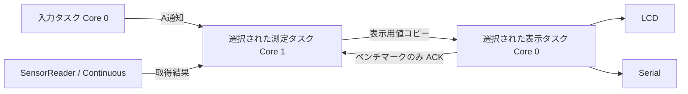

# ミニ四駆ラップタイマー FW機能設計書

## 1. 文書の目的と適用範囲

[要求仕様書](requirement.md)を実現する現行FWの機能・構造・インターフェースを定義する。基準実装はコミット608f881、整理日2026-10-11。対象は通常ラップタイマーと開発用ベンチマークの2ビルド。今回の章構成整理ではFWの動作を変更しない。

設計変更は該当機能の節と、その状態・データ・外部仕様・検証項目を更新する。実装段階、レビュー経緯、不具合対応の履歴は[.steering](../.steering/)とGit履歴で管理し、段階別の章を追加しない。章構成は[汎用テンプレート](../skills/fw-functional-design/assets/functional_design.md)に合わせる。

## 2. 動作前提・構成と設定

### 2.1 ハードウェア・依存関係

M5Stack Core ESP32、VL53L0X、Arduino framework、FreeRTOS、M5Unified/M5GFX、Pololu VL53L0Xライブラリを使用する。センサーはスタート地点で下向きに設置し、単一車体の通過を距離の短縮で検出する。

| 項目 | 設定 |
| --- | --- |
| I²Cピン・クロック | SDA=21、SCL=22、400kHz |
| 測定時間設定値 | 20000µs |
| I²C通信タイムアウト | 20ms |
| 距離取得待ちタイムアウト | 1000ms |
| LCD | 320×240、setRotation(1) |
| Serial | 115200bps |
| 計測時計 | esp_timer_get_time()、起動後経過µs、uint64_t |
| 永続保存 | なし。記録はRAMのみ。 |

Continuousモードは起動時に一度だけ開始し、A操作・計測完了・再測定で停止や再初期化を行わない。基準距離取得時はセンサー下に車体がいないことを前提とする。

### 2.2 ビルド選択

| PlatformIO環境 | LAP_TIMER_BENCHMARK_MODE | 起動動作 |
| --- | --- | --- |
| m5stack-core-esp32（既定） | 0 | 通常の待機画面 |
| m5stack-core-esp32-benchmark | 1 | 自動で50回測定 |

共通設定はplatformio.iniの[env]へ集約する。build_src_filterでタスク実装を選択し、選択ソースのstatic_assertでマクロとの整合性を検証する。マクロ未定義は0、0/1以外はビルドエラー。実行時のモード切り替えとCボタン操作はない。

通常の書き込みは `pio run -t upload`、ベンチマークは `pio run -e m5stack-core-esp32-benchmark -t upload`。ベンチマークをリセットすると自動測定を再実行する。通常機能へ戻すには通常用FWを書き込む。

## 3. 機能一覧と要求対応

機能IDは章番号と独立させ、機能追加でも既存IDを変えない。

| 機能ID | 機能 | 要求仕様の対応箇所 | 詳細 |
| --- | --- | --- | --- |
| F-INIT | センサー・タスク起動 | センサーの起動と継続動作 | 4章、6.1 |
| F-INPUT | A入力 | 状態とAボタン | 5章、6.2 |
| F-BASE | 基準距離取得 | 通過判定 | 6.3 |
| F-PASS | 通過判定 | 通過判定 | 6.4 |
| F-LAP | 10周の時間記録 | ラップ計測 | 6.5 |
| F-UI | LCD表示 | LCD表示とシリアル出力 | 6.6、9.1 |
| F-LOG | 基準距離・デバッグ出力 | LCD表示とシリアル出力 | 9.2 |
| F-BENCH | 50回測定・再測定 | 測定周期計測の開発用ビルド | 6.7、8.2、9.3 |

複数車体識別、永続保存、センサー自動再起動は対象外。

## 4. ソフトウェア構造とライフサイクル

### 4.1 モジュールと責務

| モジュール | 責務 |
| --- | --- |
| main.cpp | M5/Serial初期化、SensorReaderの初期化、タスク起動。loopは待機のみ。 |
| TimerTasks / TaskRuntime | 共通入力、開始ゲート、タスク・キュー生成と失敗時破棄 |
| LapTimerTasks | 通常の測定・表示ループ。ベンチマーク分岐・ACKを持たない。 |
| BenchmarkTasks | 専用の測定・表示ループ。通常計測の中核を使用しない。 |
| SensorReader / SensorTypes | 一度だけのセンサー起動、距離取得、取得結果・エラー変換 |
| LapTimer / MeasurementFlow | 状態、平均、通過、時刻計算、Aと取得結果の競合 |
| DisplayModel / TimerDisplay | 表示値生成、時刻整形、差分LCD、Serial、ベンチマーク画面 |
| Benchmark / BenchmarkData | 50件の逐次記録・結果の固定・CSV・集計 |
| BenchmarkSession / BenchmarkAcquisition | 準備・捕捉・出力・再測定、ACK、取得後の通知判定 |

通常ビルドはBenchmarkTasks/Benchmark/BenchmarkData/BenchmarkSessionのcppを除外する。ベンチマークビルドはLapTimerTasks/LapTimerのcppを除外する。共通TimerDisplayに置く表示ヘルパーの未使用関数はリンク時に除去する。



### 4.2 起動・終了

1. M5.begin()、Serial.begin(115200)。
2. SensorReader.initialize()でI²C、ライブラリ初期化・校正、測定時間設定、Continuous開始。一度だけのラッチを持つ。
3. startTimerTasks()で開始ゲートとビルド固有キューを作成し、選択されたconfigureModeTasks()を実行。
4. 表示・入力・測定タスクを生成する。全タスクは開始ゲートを待つ。
5. 全生成成功後にゲートを開く。通常は初期状態を通知、ベンチマークはsession.start()から準備を開始。

生成失敗時はゲートを開かず、作成済みタスク・キュー・ゲートを破棄する。setupから最小限のSYSTEM_RESOURCE診断を出す。センサーの起動失敗でもタスクは起動し、通常はエラー表示、ベンチマークは取得失敗の結果を出す。

電源断・本体リセットでRAMの結果は失われる。通常のタスク終了やセンサー停止処理は設けない。

## 5. 状態・イベント・競合規則

### 5.1 通常状態

| 状態 | 入力・イベント | 処理と次状態 |
| --- | --- | --- |
| Idle | A | 記録クリア・世代更新、Calibrating |
| Calibrating | A | 合計・進捗・読み捨てをリセットして再取得 |
| Calibrating | 正常10件取得完了 | Armed |
| Armed | 通過 | 開始時刻保存、Running。ラップ数0。 |
| Running | 通過 | 1件確定。10件目でComplete。 |
| Armed/Running/Complete/Error | A | 記録クリア・再校正。ただし起動失敗ラッチは解除しない。 |
| 起動成功後の通常状態 | 取得異常 | Error。確定記録と終了時刻を保持。 |
| Complete | 追加通過 | 無視 |
| Error | 後続取得・異常 | 最初のエラーと終了時刻を維持 |

待機・完了・エラーでも起動成功時は取得を継続する。起動失敗時は取得APIを呼ばず、50ms待ちでA通知を確認する。

### 5.2 ベンチマーク状態

| 状態 | イベント | 処理と次状態 |
| --- | --- | --- |
| 起動 | start | 実行番号更新、Preparing |
| Preparing | 現実行のQuiet ACK | Capturing、記録初期化 |
| Preparing | 2秒経過 | 全行NOT_RUN、Results、BENCH_PREP_TIMEOUT |
| Capturing | 50件完了または取得失敗 | 配列固定、Results |
| Results | 現実行のOutputDone ACK | 予約ありなら新Preparing、なければFinished |
| Finished | A | 新Preparing |
| Preparing/Capturing/Results | A | 次の1回を予約。連打は集約。 |
| 全状態 | 古い実行番号・不適切なACK | 無視 |

Cは両ビルドで使用しない。再測定でもセンサーは動かしたままとする。

### 5.3 競合と優先順位

通常側はAPI前後でAを確認する。取得中のAと正常値が重なった場合は新校正を開始し、旧取得値を投入しない。Aと取得異常が重なった場合は異常を優先し、確定ラップを保持してAを消費する。校正の読み捨ては次の取得結果に適用する。

ベンチマーク側のAは予約として保持する。出力完了ACKまでは結果配列を変更しない。processBenchmarkSample()は取得後の状態または実行番号変更を戻り値で知らせ、測定タスクは必ずpublish()する。これにより取得中のAによる再準備も表示へ伝わる。

## 6. 機能詳細と内部インターフェース

### 6.1 F-INIT センサー取得

| 関数 | 入出力・処理 |
| --- | --- |
| SensorReader.initialize() | 起動結果Errorを返す。複数回呼ばれても実初期化を繰り返さない。 |
| collectSample() | API前後のµs時刻・距離mm・SampleStatusを返す。LCD/Serialに触れない。 |
| classifyReading() | timeout、last_status、65535の順に判定 |
| sampleError() | 取得ステータスを中核のErrorへ変換 |
| nowUs() | 64bit起動後経過µs |

起動可否と実測定時間設定の読み戻し値を保持する。APIのOKは取得成功であり、距離品質の保証ではない。

### 6.2 F-INPUT A操作

入力タスクだけがM5.update()を実行し、BtnA.wasPressed()を通知ビットで測定タスクへ渡す。短時間の複数通知は1操作にまとめる。takeACommand()は待ち時間0で通知を消費する。入力側はセンサー・描画・Serialを操作しない。

### 6.3 F-BASE 基準距離

LapTimer.onAButton()で世代番号を増やし、記録と検出ラッチを消去する。最初の正常1件を読み捨て、後続10件を合算する。読み捨て・平均対象とも失敗時はErrorへ移る。

合計Sをuint32_tで保持し、平均を丸めず判定する。校正中のAは最初から再実行。完了後の基準距離は次のAまで保持する。校正中に車体が通過しても、校正を自動でやり直す機能はない。

### 6.4 F-PASS 通過判定

符号付き整数で `delta10 = S - 10 × distanceMm` を計算する。検出はdelta10 >= 200（20mm）、離脱はdelta10 <= 100（10mm）。

- 不在→存在の遷移を通過候補とする。
- 初回通過は時間制限なし。以後は最後の受付通過から1000000µs以上の候補だけ受け付ける。
- 禁止時間中でも存在ラッチを更新する。下に留まった車体を禁止終了時に後追い検出しない。
- 受付済み車体の次を数えるには離脱・再進入が必要。
- 複数回連続検出による確認処理は追加しない。センサー取得自体は禁止時間中も継続する。

### 6.5 F-LAP 記録と時刻計算

LapTimerはハードウェアに依存せず、onSample(distanceMm, readEndUs, error)で取得結果を受け取る。initialize()は起動結果設定、context()は読み取り専用の状態参照、elapsedUs(nowUs)は経過時間の参照。

初回受付をstartUsとpreviousPassUsへ保存する。以後は `lapUs = passUs - previousPassUs`、`elapsedUs = passUs - startUs`。固定配列へ10件を確定し、10周で経過時間を固定する。1周目はlapUs=elapsedUs。確定フラグと表示用の初期0.00は区別する。

外部時刻は単調非減少を前提とする。通過時刻には距離取得APIの終了時刻を使い、サンプリングと通信による遅れを含む。

### 6.6 F-UI 表示値生成

makeDisplayModel()は状態・世代・エラー・校正進捗・基準距離合計と確定可否・経過時間・10行を値コピーする。Runningだけ現在時刻から経過を計算し、Complete/Errorは固定値を使う。

formatSeconds()/formatCentiseconds()は整数の10000µs単位へ切り捨てて秒・小数2桁へ整形する。バッファ不足はfalseと空文字で知らせ、黙って切り詰めない。sameDisplayModel()/sameRow()は表示内容の比較であり、パディングのmemcmpは行わない。

### 6.7 F-BENCH 捕捉と集計

BenchmarkData.begin()で50件をNOT_RUNへ戻す。consume()で最初の正常値を読み捨て、その後最大50件を記録する。読み捨てが失敗した場合は失敗を先頭行に残す。途中失敗はそこで終了し、以後はNOT_RUN。done後のconsumeは配列を変更しない。

summary()は試行数・成功数・エラー・所要時間・間隔を返す。所要時間は正常行のreadEndUs-readStartUs、間隔は隣接する正常行同士の終了時刻差。先頭の間隔は集計しない。最小・平均・最大を計算し、対象件数0では集計なしとする。

BenchmarkSessionはstart/requestAgain/poll/acknowledge/captureDoneで5.2の遷移を管理する。Benchmarkは記録を測定側、printResults()を表示側で呼ぶ。capture()も保持するが、タスクの本経路では逐次consumeを使用する。

## 7. タスク・割り込み・実行順序

| タスク | Core | 優先度 | スタック(bytes) | 処理・待ち |
| --- | --- | --- | --- | --- |
| measurementTask | 1 | 3 | 6144 | 選択ビルドの取得・状態管理。取得ごと1tick待ち。 |
| inputTask | 0 | 2 | 3072 | 10ms周期のM5.update/A通知 |
| presentationTask | 0 | 1 | 8192 | 通常は50ms以上の間隔。専用側は50ms周期の要求確認。 |

同時に動くのは選択ビルドの3タスクだけ。ユーザー定義ISRはない。センサーAPIは完了待ちを含むブロッキング処理。

通常測定の順序：A確認→取得→A再確認→取得異常/中核更新→必要な値コピー→1tick待ち。ベンチマークは準備要求→Quiet ACK→読み捨て/捕捉→結果要求→OutputDone ACK→再測定またはA待ち。

M5.updateは入力タスク、LCD/Serialは表示タスク、SensorReaderは測定タスクだけが使用する。setupの初期化・起動エラー診断は例外。loopは1000ms待機のみ。

## 8. データ・通信・同期と所有権

### 8.1 通常ビルド

| データ・経路 | 所有者・受け渡し |
| --- | --- |
| SensorSample | 測定側のAPI前後時刻・距離・結果 |
| TimerContext/LapRecord[10] | 測定側が唯一の更新者。固定RAM。 |
| 表示キュー | 長さ1、TimerContextを値コピー。xQueueOverwriteで測定側を待たせない。 |
| DisplayModel | 表示側のローカル値。共有contextを直接読まない。 |
| A通知 | 共通入力→測定のタスク通知ビット |

全10件をスナップショットへ含めるため、途中通知の上書きで現在の記録は消えない。世代変更時は旧画面を消す。新世代へリセットした後まで旧世代の全ログを保存する保証はない。入力用状態キューとベンチマークACKキューは通常側では作らない。

### 8.2 ベンチマークビルド

| データ・経路 | 所有者・受け渡し |
| --- | --- |
| BenchmarkSession | 測定側が更新。Phase/実行番号/予約を保持。 |
| 表示キュー | 長さ1、{phase, run}を値コピー |
| ACKキュー | 長さ2、表示→測定へ{QuietまたはOutputDone, run} |
| SensorSample[50] | 測定側が捕捉中に更新。ResultsからOutputDoneまで固定。 |

Preparing/ResultsはACKを受けるまで保持されるため、最新通知の上書きで要求を失わない。表示側は実行番号ごと1回処理し、ACK送信に失敗したら次周期に再試行する。測定側は非ブロッキングで受信し、古い番号と不適切な段階を無視する。

Quietは準備画面とSerial.flush()の完了後に発行する。OutputDoneはCSVの送信完了と終了画面描画の後に発行する。測定側はACK待ちでも取得を続ける。公開した配列を出力中に上書きしないことが再測定の不変条件。

## 9. 外部インターフェース・画面・ログ

### 9.1 LCD

| 領域 | 座標・サイズ(px) | 表示 |
| --- | --- | --- |
| 状態行 | 0,0,320,20 | 状態、確定周数/10 |
| 経過時間 | 0,20,320,28 | 秒、小数2桁 |
| 見出し | 0,48,320,16 | 周 / ラップ(s) / 累積(s) |
| 表 | 0,64,320,150 | 15px×10行。右端28/168/306。 |
| A案内 | 0,216,108,24 | Idleはスタート、他の通常状態はリセット |
| 補助 | 114,216,206,24 | 校正進捗・エラー・状態説明 |

日本語はlgfxJapanGothic_12、数字はFont0。表1.5倍、経過2.5倍。長い値は1倍まで縮小し、幅超過ならLCDだけOVFとする。内部値とSerialの全桁は維持する。

初回・世代変更時は全画面を消去し、以後は変更領域だけ更新する。桁数減少時も背景を消して残像を防ぐ。最新確定行を強調する。未確定行は--.--、Idle/Calibratingの1行目は仮の0.00、Armedでは全行未確定。

| 通常状態 | 経過時間・案内 |
| --- | --- |
| Idle | 0.00、A スタート |
| Calibrating | 0.00、進捗n/10、A リセット |
| Armed | 0.00、車体通過待ち、A リセット |
| Running | 現在経過時間、A リセット |
| Complete | 10周終了時の値、A リセット |
| Error | 終了時の値・確定結果・エラーコード、A リセット |

ベンチマークは準備画面を描いて静止し、捕捉中の進捗は描かない。終了画面に取得数/50・成功数、間隔のMIN/MEAN/MAX(ms)、エラーまたはCSV案内、A 再測定、リセットで自動再測定を表示する。集計なしは--.--。

[待機](images/lcd_idle.svg) / [基準距離取得](images/lcd_calibration.svg) / [スタート待ち](images/lcd_armed.svg) / [計測中](images/lcd_running.svg) / [完了](images/lcd_complete.svg) / [エラー](images/lcd_error.svg) / [ベンチマーク終了](images/lcd_benchmark.svg)


### 9.2 通常Serial

基準距離確定後、表示側が合計/10と合計%10から小数1桁の平均mmを整形し、確認できた世代につき1回出力する。校正途中・未確定値は出さない。

```text
BASELINE SESSION=2 SAMPLES=10 DISTANCE_MM=300.5
```

LCD相当の10行ラップ表・状態・経過時間を出すoutputSerial()は保持する。LapTimerTasks.cppのDebug lap outputの宣言・呼び出し2ブロックをコメントアウトしており、復元時は最大2Hz・同一静止内容の重複抑止を使う。

### 9.3 ベンチマークSerial

```text
index,read_start_us,read_end_us,read_duration_us,interval_us,distance_mm,status
```

常に50行。最初のintervalは空欄。失敗行の距離・所要時間・間隔は空欄、未実行はNOT_RUN。statusはOK/TIMEOUT/I2C_ERROR/READ_ERROR/INIT_ERROR/CONFIG_ERROR/NOT_RUN。設定値・成功数・集計件数・µsの最小/平均/最大・エラーをコメントで出す。

時刻は起動後µs、read_start/endはAPIの呼び出し前/戻り直後。read_durationはAPI所要時間で、センサーの積分時間ではない。1tick待ちを含む現在の条件をコメントに残す。

## 10. 異常検出・復旧と記録保持

| エラー | 判定 | 動作・復旧 |
| --- | --- | --- |
| SENSOR_INIT/SENSOR_CONFIG | センサー起動処理失敗 | 起動失敗をラッチ。Aで再初期化せず、本体リセットで再試行。 |
| SENSOR_TIMEOUT | timeoutOccurred() | 通常はError、Aで再校正。専用側は失敗行を記録しA再試行。 |
| SENSOR_I2C | API終了時last_status != 0 | 同上 |
| SENSOR_READ | タイムアウト以外の65535等 | 同上 |
| BENCH_PREP_TIMEOUT | 準備から2秒以内にQuiet未受領 | 全行NOT_RUNで結果公開。出力後にA再試行可能。 |
| SYSTEM_RESOURCE | キュー・タスク生成失敗 | 部分起動を破棄。setup診断、本体リセット。 |

通常の異常時は経過時間を異常検出時刻で固定し、確定ラップを保持する。Complete後の異常は完了時の経過時間を維持する。Error中の後続異常で最初のエラーを上書きしない。Aで初めて記録をクリアする。

last_statusは最後のI²C送信結果のみで、全内部通信失敗・受信バイト不足・距離品質を保証して検出しない。異常値は通過イベントにしない。自動再初期化やタイムアウト変更は今回の仕様に含めない。

## 11. タイミング・性能・資源

| 項目 | 設定・意味 |
| --- | --- |
| 通過しきい値 | 検出20mm、復帰10mm。暫定・実測調整対象。 |
| 検出禁止 | 1000000µs。1秒未満の周回は対象外。 |
| 校正・記録数 | 校正10件、通常10周、ベンチマーク50件。 |
| FreeRTOS tick | 現SDKは1000Hz、1tick=1ms。待ちは最低1tick。 |
| 通常LCD | 描画終了から50ms以上、最大20Hz |
| 通常Serial | 出力終了から500ms以上、最大2Hz。平均は世代ごと1回。 |
| ベンチマーク表示確認 | 50ms周期。捕捉中は描画・出力なし。 |
| 準備タイムアウト | 2秒。poll実行までのAPI待ちの影響を含む。 |

センサー待ち1000ms中はAの計測側反映が遅れる。Serial送信待ちで表示更新も遅れることがあるが、測定側が表示完了を待つ同期は通常計測にない。コア間コピー・通知による短い同期は残り、完全なゼロ遅延は保証しない。

車体のセンサー下滞在時間が測定周期より短い場合は取り逃がす可能性がある。0.01秒表示は測定精度の保証ではない。1tick待ちはアイドル実行機会の確保に使う。

基準608f881の確認値：通常Flash 592305 bytes/静的RAM 25980 bytes、専用Flash 595173 bytes/静的RAM 26916 bytes。動的なタスクスタック・キューの使用量は別途評価する。スタックhigh-water mark、ウォッチドッグ、表示負荷を含む定量周期比較は未測定。

## 12. 検証方針・要求追跡と未解決事項

### 12.1 検証対応

| 機能ID | 主な確認 | 方法 |
| --- | --- | --- |
| F-INIT | 初期化1回、Continuous停止なし、起動失敗 | コード確認・両ビルド・実機 |
| F-INPUT/F-BASE | 全状態のA、読み捨て、平均10件、取得中Aと異常 | lap_timer/measurement_flowテスト |
| F-PASS | 20/10mm境界、小数平均、1秒境界、滞留・後追い防止 | lap_timerテスト・実機 |
| F-LAP | 初回開始、1周目一致、10周終了、64bit時刻、エラー保持 | lap_timerテスト |
| F-UI/F-LOG | 全状態、初期値、10行、切り捨て、平均表示、再描画 | display_modelテスト・実機 |
| F-BENCH | 自動開始、A予約、遅延ACK、配列固定、通知、NOT_RUN、集計 | benchmark_sessionテスト・実機 |
| ビルド選択 | マクロ/フィルタ整合、不要シンボル除外 | 両環境ビルド・ELF確認 |

[ホストテスト手順](../test/lap_timer/README.md)のrun_tests.pyをWSL2のg++で実行する。現行基準は246+34+96+191=567チェック成功、両環境ビルド成功、ユーザー実機動作確認済み。文書再構成に際してFWコード変更・再ビルドは行わない。過去のテスト数・実装段階はステアリング記録を参照する。

### 12.2 保留・実測項目

- 設置高さ、車体通過時の距離差、20/10mmしきい値の実測調整。
- 表示静止/最大負荷での取得周期、入力応答、スタック余裕、ウォッチドッグ。
- LCDフォントの実際の視認性と長時間桁数の収まり。
- 要求仕様は「各計測世代につき1回平均出力」とするが、現行は最新キューと2Hz制限のため、短時間に再校正を繰り返すと旧世代の結果を出す前に上書きされ得る。仕様への厳密適合は未検証。今回の文書整理でコードや要求は変更しない。

現行コード・要求が食い違う箇所は本節で明示し、設計書の整理だけで新しい動作を決定しない。
